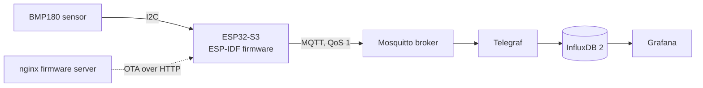
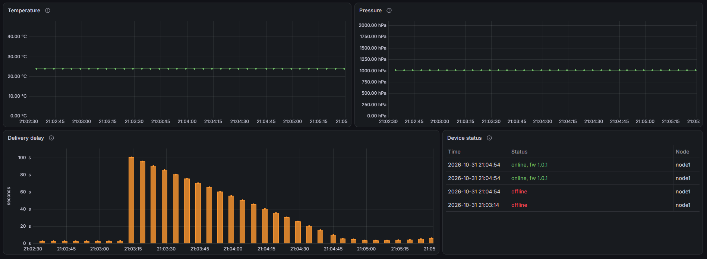
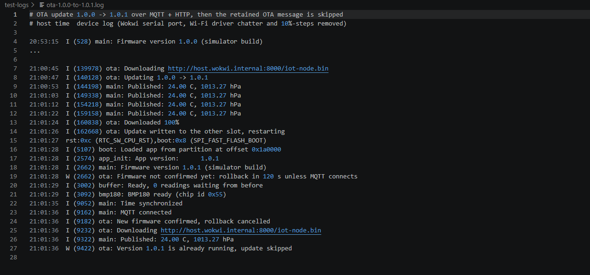
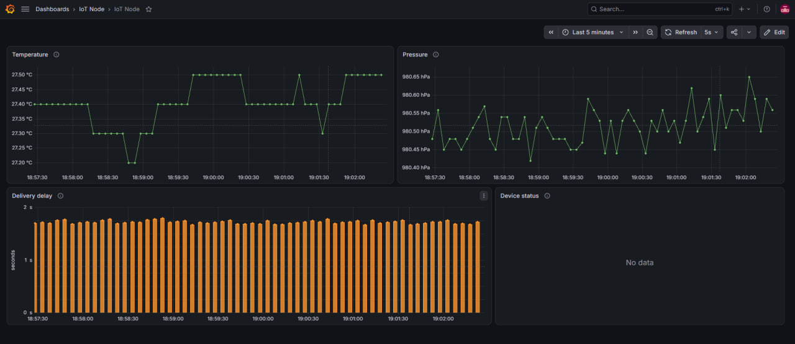

# IoT Sensor Node (ESP32-S3 + MQTT + InfluxDB + Grafana)

An ESP32-S3 reads temperature and pressure from a BMP180 sensor over I2C and publishes the readings over MQTT. A Docker stack on a PC (Mosquitto, Telegraf, InfluxDB, Grafana) stores them and draws the graphs. The firmware is written in C with ESP-IDF.

The point of the project is what happens when things go wrong. Every reading is timestamped on the device. If the network or the broker goes down, the readings are kept in flash and sent again, oldest first, when the connection is back, so the graph has no hole in it. Wi-Fi reconnects with exponential backoff, and the firmware can be updated over the air with automatic rollback if the new version doesn't work.

## Architecture



The BMP180 gives raw values, which the firmware turns into degrees and hPa using the calibration data stored in the sensor. Mosquitto sits between the device and everything else, so the device doesn't need to know who is listening. Telegraf subscribes to the topics and writes into InfluxDB, using the timestamp from the device. Grafana reads from InfluxDB. nginx serves the firmware files for OTA updates, and its HTTP `Date` header doubles as a backup time source.

## What the firmware does

The sensor driver uses the ESP-IDF `i2c_master` driver. It checks the chip ID, reads the calibration, and runs the integer compensation algorithm from the datasheet. If the sensor isn't found, the node still goes online and keeps looking for it, and the log lists every I2C address that does answer, which helps when debugging wiring.

Readings go out over MQTT with QoS 1 as JSON. There is also a retained `status` topic with a Last Will, so the broker publishes `offline` if the device disappears.

Time comes from SNTP. If NTP is blocked (UDP 123), the firmware falls back to the `Date` header of an HTTP request to the server.

A reading counts as delivered only when the broker acknowledges that exact message. Anything else is appended to a file in a SPIFFS partition and re-sent in order after reconnecting. A record is deleted only after it was acknowledged, and the file survives reboots and power loss.

Wi-Fi reconnects after 1 s, 2 s, 4 s and so on up to 60 s, with some random jitter, and the log shows why a connection failed (wrong password, network not found).

OTA updates are triggered by publishing a URL to the `ota` topic. The image is written to the other of two app partitions. A new firmware has 120 seconds to connect to the MQTT broker; if it doesn't, it marks itself invalid and the bootloader goes back to the old version. The device refuses to install the version it is already running, and versions that were rolled back before.

## Test results

I tested buffering and OTA first in the Wokwi simulator, then on a real board. Full device logs are in [`test-logs/`](test-logs).

### Broker outage (simulator)

I stopped the MQTT broker for 90 seconds. The device buffered 18 readings, reconnected one second after the broker came back and sent all 18 within 3 seconds. Largest gap between two stored readings: 5 seconds, which is the normal measurement period.



Temperature and pressure show no gap. The "Delivery delay" panel shows how long after the measurement each reading arrived: the oldest buffered one was 100 seconds late, the rest are close to zero.

### OTA update 1.0.0 to 1.0.1 (simulator)

The device downloaded the 1 MB image while it kept publishing, rebooted into the other slot, and confirmed the new version after connecting to MQTT. The OTA message was still on the broker, so the new firmware received it again after the reboot and correctly skipped it instead of updating in a loop.



```
I (139978) ota: Downloading http://host.wokwi.internal:8000/iot-node.bin
I (140128) ota: Updating 1.0.0 -> 1.0.1
I (160838) ota: Downloaded 100%
I (162668) ota: Update written to the other slot, restarting
rst:0xc (RTC_SW_CPU_RST),boot:0x8 (SPI_FAST_FLASH_BOOT)
I (5107) boot: Loaded app from partition at offset 0x1a0000
I (2662) main: Firmware version 1.0.1 (simulator build)
W (2662) ota: Firmware not confirmed yet: rollback in 120 s unless MQTT connects
I (9162) main: MQTT connected
I (9182) ota: New firmware confirmed, rollback cancelled
W (9422) ota: Version 1.0.1 is already running, update skipped
```

### Rollback (simulator)

I built a 1.0.2 that points at the wrong MQTT port and offered it over OTA, with the confirm timeout shortened to 30 seconds. It installed, couldn't reach the broker, and rolled back to 1.0.1 by itself. The 5 readings it had buffered survived both reboots and were delivered by 1.0.1. When I offered 1.0.2 again, the device answered `Version 1.0.2 was rolled back before, update skipped`.

### Real hardware

The same tests on an ESP32-S3 DevKitC-1 with a BMP180, talking to the PC over Wi-Fi.



This is the last 5 minutes of live data from the board. Readings arrive every 5 seconds. The temperature moves in 0.1 °C steps between 27.2 and 27.5, and the pressure wobbles by 0.1 to 0.2 hPa, which is normal for a BMP180 without oversampling. The delivery delay is flat at about 1.7 seconds. Since it doesn't change, it is most likely the difference between the board's clock and the PC's clock rather than network time.

The board joined Wi-Fi after 3 seconds. The sensor wasn't found on the first two attempts and was found on the third, 5 seconds later, and the node was already online and publishing in between ([log](test-logs/hardware-boot.log)). That was probably a loose jumper wire.

For the outage I stopped the broker for 90 seconds. The board buffered 19 readings and sent all of them 5 seconds after the broker returned, and `tools/outage-test.ps1` reported no gap ([log](test-logs/hardware-broker-outage.log)).

The OTA update from 1.0.0 to 1.0.1 downloaded in 21 seconds over Wi-Fi, rebooted, and confirmed itself. NTP didn't answer after that reboot, so the HTTP `Date` fallback set the clock, which was a nice accidental test of that path ([log](test-logs/hardware-ota-1.0.0-to-1.0.1.log)).

## Repository structure

```
iot-node/
├── main/                     ESP-IDF application
│   ├── main.c                startup, MQTT, time sync, main loop
│   ├── app_config.h          settings: simulator or board, topics, intervals, pins
│   ├── secrets.example.h     template for Wi-Fi and server address on a real board
│   ├── bmp180.c / .h         sensor driver
│   ├── wifi.c / .h           Wi-Fi station with exponential backoff
│   ├── buffer.c / .h         offline buffer in flash (SPIFFS)
│   ├── ota.c / .h            OTA update, version checks, rollback timer
│   └── idf_component.yml     managed dependency: espressif/mqtt
├── server/                   Docker Compose stack
│   ├── compose.yaml
│   ├── mosquitto/mosquitto.conf
│   ├── telegraf/telegraf.conf
│   ├── grafana/provisioning/ data source and the "IoT Node" dashboard
│   └── firmware/             firmware images served for OTA
├── tools/
│   ├── ota.ps1               build a version and offer it to the device
│   └── outage-test.ps1       stop and start the broker, then check InfluxDB for gaps
├── test-logs/                device logs from the tests above
├── partitions.csv            flash layout
├── diagram.json, wokwi.toml  Wokwi circuit and config
└── sdkconfig                 ESP-IDF project configuration
```

## MQTT topics

```
iot-node-6g7l/node1/env      device to server   {"ts":1760780000123,"temperature":24.00,"pressure":1013.27}
                                                ts is Unix time in milliseconds
iot-node-6g7l/node1/status   device to server   "online, fw 1.0.0" or "offline" (Last Will), retained
iot-node-6g7l/node1/ota      server to device   URL of a firmware image,
                                                e.g. http://<server>:8000/iot-node-1.0.1.bin
```

## Flash layout

The board has 4 MB of flash, split like this (see `partitions.csv`):

```
nvs        24 KB    Wi-Fi calibration and system settings
otadata     8 KB    which OTA slot to boot
phy_init    4 KB    RF calibration data
ota_0     1.5 MB    firmware slot A
ota_1     1.5 MB    firmware slot B
storage   896 KB    SPIFFS file system for the offline buffer
```

## Getting started

### Server

You need Docker Desktop.

```
cd server
docker compose up -d
```

Grafana is at http://localhost:3000 (login `admin` / `admin`) and the dashboard is at http://localhost:3000/d/iot-node. InfluxDB is on port 8086 and the MQTT broker on 1883. The credentials in `compose.yaml` are development defaults for a local machine only. After editing the dashboard JSON, run `docker compose restart grafana`.

### Firmware in the simulator

You need VS Code with the ESP-IDF extension (ESP-IDF v6.1) and the Wokwi Simulator extension.

1. Open the project folder and set the target to `esp32s3`. `main/app_config.h` has `USE_SIMULATOR 1`.
2. Build with **ESP-IDF: Build Your Project**.
3. Start **Wokwi: Start Simulator**. The simulated ESP32 reaches your PC through `host.wokwi.internal`. Its serial port is also available on `rfc2217://localhost:4000`.

Keep the simulator tab visible. VS Code pauses the simulation when its window is hidden, and the device clock stops with it.

### Firmware on a real board

You need an ESP32-S3 DevKitC-1, a BMP180 module (GY-68), four jumper wires and a USB cable that carries data.

Wiring:

```
BMP180 VIN (or 3.3V)  to  3V3
BMP180 GND            to  GND
BMP180 SDA            to  GPIO 8
BMP180 SCL            to  GPIO 9
```

1. In `main/app_config.h`, set `USE_SIMULATOR` to `0`.
2. Copy `main/secrets.example.h` to `main/secrets.h` and fill in your Wi-Fi name (2.4 GHz only), the password, and the IPv4 address of the PC that runs Docker (`ipconfig` shows it). `secrets.h` is git-ignored.
3. On Windows, set the Wi-Fi network to Private (Settings, Network & internet, Wi-Fi, your network, Network profile type) and allow the two ports through the firewall. Run this once in an administrator PowerShell:
   ```
   New-NetFirewallRule -DisplayName "IoT node: MQTT and OTA" -Direction Inbound -Protocol TCP -LocalPort 1883,8000 -RemoteAddress LocalSubnet -Profile Private -Action Allow
   ```
4. Plug in the board and pick its COM port with **ESP-IDF: Select Port to Use**, then run **ESP-IDF: Build, Flash and Start a Monitor**. In an ESP-IDF terminal this is `idf.py -p COM5 flash monitor`, and `Ctrl+]` leaves the monitor.

The first boot formats the storage partition, which takes a few seconds. After that the log should look like this:

```
I (...) main: Firmware version 1.0.0 (hardware build)
I (...) bmp180: BMP180 ready (chip id 0x55)
I (...) wifi: Connected, IP 192.168.x.x
I (...) main: Time synchronized
I (...) main: MQTT connected
I (...) main: Published: 22.40 C, 1009.85 hPa
```

If something is wrong, the log usually says what:

- `bmp180: No device at 0x77`, followed by a bus scan: the sensor isn't found. Check SDA, SCL, 3.3 V and GND. The scan lists the addresses that did answer.
- `Unexpected chip id 0x58: this is a BMP280`: the module is a BMP280, which is often sold as a BMP180. It needs a different driver.
- `wifi: Disconnected (reason 201, network not found ...)`: wrong SSID, or a 5 GHz-only network.
- `wifi: Disconnected (reason 15, wrong password?)`: wrong Wi-Fi password.
- `main: MQTT error (broker mqtt://192.168.x.x)`, repeating: the board can't reach the PC. Check `SERVER_HOST`, the firewall rule from step 3, and whether your network isolates devices from each other (guest networks often do).
- `main: No valid time yet`: NTP isn't answering and port 8000 on the PC isn't reachable either.

To go back to the simulator, set `USE_SIMULATOR` to `1` again.

### Testing the offline buffer

```
.\tools\outage-test.ps1
```

This stops the broker for 90 seconds, starts it again, and asks InfluxDB whether any reading is missing. `PASS: no gap` means everything measured during the outage arrived. You can also do it by hand with `docker compose stop mosquitto`, a wait, and `docker compose start mosquitto`.

### Testing OTA

From an ESP-IDF terminal (**ESP-IDF: Open ESP-IDF Terminal**):

```
.\tools\ota.ps1 -Version 1.0.1                        # simulator
.\tools\ota.ps1 -Version 1.0.1 -Server 192.168.x.x    # real board, the PC's IP
```

The script builds the firmware as that version into `build-ota/` (so a running simulation isn't restarted), copies the image to `server/firmware/` and publishes its URL to the `ota` topic. The device downloads it, reboots into the other slot, confirms itself after connecting to MQTT and reports the new version on the status topic, which also shows up in the dashboard.

## Tech stack

C, ESP-IDF 6.1, FreeRTOS, I2C, MQTT (esp-mqtt), SPIFFS, SNTP, OTA. Mosquitto, Telegraf, InfluxDB 2, Grafana, nginx, Docker Compose. Wokwi for simulation.
