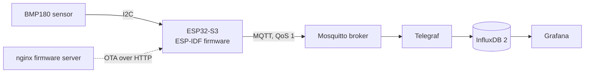

# IoT Sensor Node (ESP32-S3 + MQTT + InfluxDB + Grafana)

An industrial-style IoT sensor node written in C with ESP-IDF. An ESP32-S3 reads temperature and pressure from a BMP180 sensor over I2C, publishes the readings over MQTT, and a Docker-based server stack stores them in InfluxDB and visualizes them in Grafana.

The firmware is built to survive real network conditions: it timestamps every reading on the device, buffers readings in flash while the network is down and re-sends them once it’s back, reconnects with exponential backoff, and can be updated over the air with automatic rollback.

!image.png

## Architecture



| Component | Role |
| --- | --- |
| **BMP180** | Measures temperature and barometric pressure. Returns raw values that are compensated on the ESP32 using the sensor’s factory calibration coefficients. |
| **ESP32-S3 firmware** | Reads the sensor, timestamps readings, publishes them over MQTT, buffers them in flash when offline, handles OTA updates. |
| **Mosquitto** | MQTT broker. Decouples the device from everything that consumes its data. |
| **Telegraf** | Subscribes to the sensor topics, parses the JSON payload and writes points into InfluxDB. |
| **InfluxDB 2** | Time-series database. Stores readings with the device timestamp; node name is stored as a tag. |
| **Grafana** | Dashboards on top of InfluxDB (provisioned data source, Flux queries). |
| **nginx** | Serves firmware images for OTA updates. |

## Features

- **I2C sensor driver** for the BMP180 using the ESP-IDF `i2c_master` driver: chip ID check, calibration readout, and the integer compensation algorithm from the datasheet.
- **MQTT publishing** with QoS 1, JSON payloads, and a `status` topic with **Last Will and Testament** (the broker publishes `offline` if the device disappears).
- **Device-side timestamps** via SNTP, with a fallback to the HTTP `Date` header when NTP (UDP 123) is blocked.
- **Store-and-forward buffering**: every reading waits for the broker’s PUBACK; undelivered readings are stored in a SPIFFS file and re-sent oldest-first after reconnecting. Records are deleted only after the broker acknowledges them.
- **Exponential backoff with jitter** for Wi-Fi reconnects (1 s → 2 s → 4 s … capped at 60 s).
- **OTA firmware updates** triggered over MQTT, using A/B app partitions and **automatic rollback**: new firmware stays in “pending verify” until it successfully connects to MQTT.
- **One-command server stack** with Docker Compose.

## Repository structure

```
iot-node/
├── main/                     ESP-IDF application
│   ├── main.c                startup, MQTT, time sync, main loop
│   ├── app_config.h          all settings (Wi-Fi, topics, intervals, pins)
│   ├── bmp180.c / .h         sensor driver
│   ├── wifi.c / .h           Wi-Fi station with exponential backoff
│   ├── buffer.c / .h         offline buffer in flash (SPIFFS)
│   ├── ota.c / .h            OTA update and rollback confirmation
│   └── idf_component.yml     managed dependency: espressif/mqtt
├── server/                   Docker Compose stack
│   ├── compose.yaml
│   ├── mosquitto/mosquitto.conf
│   ├── telegraf/telegraf.conf
│   ├── grafana/provisioning/datasources/influxdb.yaml
│   └── firmware/             firmware images served for OTA
├── partitions.csv            flash layout (2 OTA slots + storage)
├── diagram.json, wokwi.toml  Wokwi simulator circuit and config
└── sdkconfig                 ESP-IDF project configuration
```

## MQTT interface

| Topic | Direction | Payload |
| --- | --- | --- |
| `iot-node-6g7l/node1/env` | device → server | `{"ts":1760780000123,"temperature":24.00,"pressure":1013.27}`, `ts` in Unix milliseconds |
| `iot-node-6g7l/node1/status` | device → server (retained) | `online, fw 1.0.0`, or `offline` (Last Will) |
| `iot-node-6g7l/node1/ota` | server → device | URL of a firmware image, e.g. `http://<server>:8000/iot-node.bin` |

## Flash layout

| Partition | Size | Purpose |
| --- | --- | --- |
| `nvs` | 24 KB | Wi-Fi calibration and system settings |
| `otadata` | 8 KB | Which OTA slot to boot |
| `phy_init` | 4 KB | RF calibration data |
| `ota_0`, `ota_1` | 1.5 MB each | Two firmware slots (A/B updates) |
| `storage` | 896 KB | SPIFFS file system for the offline buffer |

## Getting started

### Server

Requires Docker Desktop.

```
cd server
docker compose up -d
```

- Grafana: http://localhost:3000 (default login `admin` / `admin`)
- InfluxDB: http://localhost:8086
- MQTT broker: `localhost:1883`

The credentials in `compose.yaml` are development defaults for a local machine only.

### Firmware (simulator)

Requires VS Code with the ESP-IDF extension (ESP-IDF v6.1) and the Wokwi Simulator extension.

1. Open the project folder, set the target to `esp32s3`.
2. Adjust `main/app_config.h` if needed (the MQTT topic prefix must match `server/telegraf/telegraf.conf`).
3. Build: **ESP-IDF: Build Your Project**.
4. Run: **Wokwi: Start Simulator**. The simulated ESP32 reaches the local server through `host.wokwi.internal`.

### Testing the offline buffer

```
docker compose stop mosquitto    # device starts buffering
docker compose start mosquitto   # device re-sends buffered readings
```

The Grafana graph shows no gap: buffered readings are stored with the time they were measured, not the time they arrived.

### Testing OTA

1. Bump `PROJECT_VER` in the root `CMakeLists.txt`, build, and copy `build/iot-node.bin` to `server/firmware/`.
2. Publish the URL `http://host.wokwi.internal:8000/iot-node.bin` to the `ota` topic.
3. The device downloads the image, reboots into the other slot, confirms itself after connecting to MQTT, and reports the new version on the `status` topic.

## Design decisions

- **Timestamps are set on the device, not on arrival.** Otherwise readings delivered from the buffer would all land at the moment of reconnection.
- **A reading is “delivered” only after PUBACK.** `esp_mqtt_client_publish()` returning a message ID only means it was queued; waiting for `MQTT_EVENT_PUBLISHED` confirms the broker actually has it.
- **At-least-once delivery, idempotent storage.** A lost acknowledgment can cause a duplicate send. InfluxDB treats a point with the same series and timestamp as the same point and overwrites it, so duplicates are harmless.
- **Rollback is confirmed only after MQTT connects.** A firmware that boots but can’t reach the network is treated as broken.
- **OTA download runs in its own FreeRTOS task** so it doesn’t block the MQTT client.

## Known limitations

- A device that boots without network access has no valid time and skips measurements until time is synchronized. A battery-backed RTC would fix this.
- When the buffer is full, new readings are dropped. A ring buffer that drops the oldest readings would be better for most use cases.
- OTA uses plain HTTP without image signing. Production use needs HTTPS and signed images (Secure Boot).
- MQTT runs without TLS or authentication.

## Tech stack

C, ESP-IDF 6.1, FreeRTOS, I2C, MQTT (esp-mqtt), SPIFFS, SNTP, OTA · Mosquitto, Telegraf, InfluxDB 2, Grafana, nginx, Docker Compose · Wokwi
