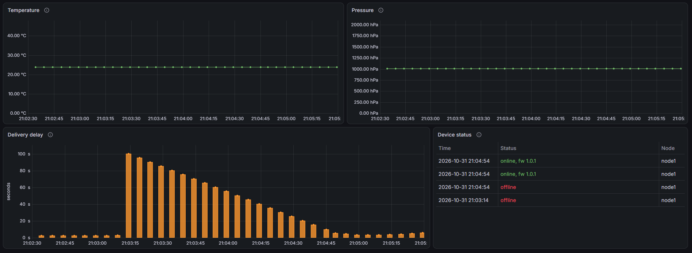
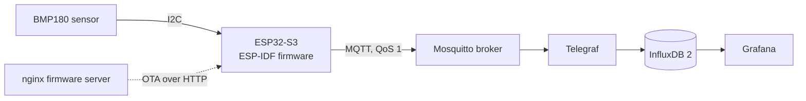
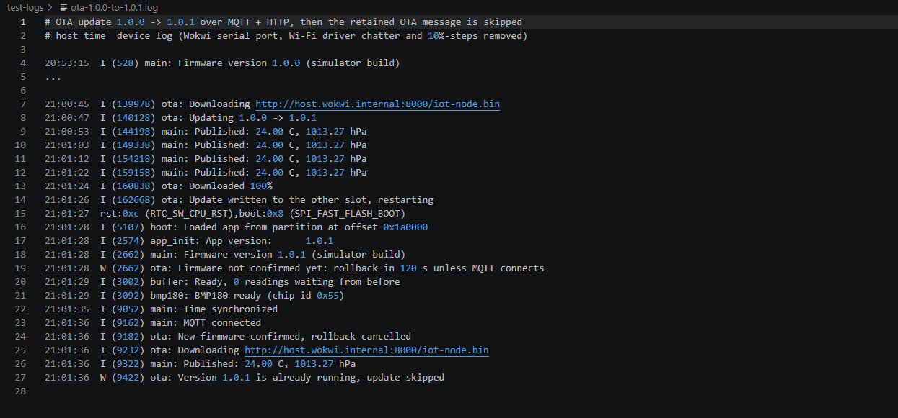

# IoT Sensor Node (ESP32-S3 + MQTT + InfluxDB + Grafana)

An industrial-style IoT sensor node written in C with ESP-IDF. An ESP32-S3 reads temperature and pressure from a BMP180 sensor over I2C, publishes the readings over MQTT, and a Docker-based server stack stores them in InfluxDB and visualizes them in Grafana.

The firmware is built to survive real network conditions: it timestamps every reading on the device, buffers readings in flash while the network is down and re-sends them once it’s back, reconnects with exponential backoff, and can be updated over the air with automatic rollback.



*The MQTT broker was stopped for 90 seconds. The temperature and pressure graphs have no gap, because the device kept measuring, stored the readings in flash and re-sent them after reconnecting. The “Delivery delay” panel shows how late each reading arrived: up to 100 s for the oldest buffered one, about 0 s otherwise.*

## Architecture



| Component | Role |
| --- | --- |
| **BMP180** | Measures temperature and barometric pressure. Returns raw values that are compensated on the ESP32 using the sensor’s factory calibration coefficients. |
| **ESP32-S3 firmware** | Reads the sensor, timestamps readings, publishes them over MQTT, buffers them in flash when offline, handles OTA updates. |
| **Mosquitto** | MQTT broker. Decouples the device from everything that consumes its data. Persists sessions across restarts. |
| **Telegraf** | Subscribes to the sensor and status topics, parses the payloads and writes points into InfluxDB. |
| **InfluxDB 2** | Time-series database. Stores readings with the device timestamp; node name is stored as a tag. |
| **Grafana** | Provisioned data source and dashboard (Flux queries): readings, delivery delay, device status. |
| **nginx** | Serves firmware images for OTA updates, and the HTTP `Date` header used as a time fallback. |

## Features

- **I2C sensor driver** for the BMP180 using the ESP-IDF `i2c_master` driver: chip ID check, calibration readout, and the integer compensation algorithm from the datasheet. If the sensor is missing, the node still goes online and keeps looking for it; the log lists every I2C address that answers.
- **MQTT publishing** with QoS 1, JSON payloads, and a `status` topic with **Last Will and Testament** (the broker publishes `offline` if the device disappears).
- **Device-side timestamps** via SNTP, with a fallback to the HTTP `Date` header when NTP (UDP 123) is blocked.
- **Store-and-forward buffering**: every reading waits for the broker’s PUBACK; undelivered readings are stored in a SPIFFS file and re-sent oldest-first after reconnecting. Records are deleted only after the broker acknowledges them, and the file survives reboots.
- **Exponential backoff with jitter** for Wi-Fi reconnects (1 s → 2 s → 4 s … capped at 60 s), with the disconnect reason in the log.
- **OTA firmware updates** triggered over MQTT, using A/B app partitions and **automatic rollback**: a new firmware has 120 s to reach the MQTT broker, otherwise it marks itself invalid and the bootloader returns to the previous one. The device refuses the version it is already running and versions that were rolled back before.
- **One-command server stack** with Docker Compose, including a ready-made Grafana dashboard.

## Test results

The first three were run on the firmware in the Wokwi simulator against the Docker stack, then the outage and OTA tests were repeated on real hardware (see below). The full device logs are in [`test-logs/`](test-logs).

| Test | What happened |
| --- | --- |
| **Broker outage** (90 s) | 18 readings buffered in flash. The device reconnected 1 s after the broker came back and re-sent all 18 within 3 s. Telegraf reconnected only 10 s later, and still received every one of them (persistent session). Largest step between two stored readings: **5 s, no gap**. |
| **OTA 1.0.0 → 1.0.1** | 1 MB image downloaded while the device kept publishing; reboot into the other slot; confirmed after connecting to MQTT. The OTA message was retained on the broker, so the new firmware received it again after the reboot and correctly skipped it instead of updating in a loop. |
| **Rollback** | OTA to a deliberately broken 1.0.2 that cannot reach the broker. After the 30 s confirm timeout (shortened for the test) it rolled back to 1.0.1 by itself. The 5 readings 1.0.2 had buffered survived the reboots and were delivered by 1.0.1. Offering 1.0.2 again: `Version 1.0.2 was rolled back before, update skipped`. |

**On real hardware** (ESP32-S3 DevKitC-1 + BMP180 over Wi-Fi, server on a PC in the same network):

| Test | What happened |
| --- | --- |
| **Boot** | Wi-Fi connected after 3 s. The sensor was missing for the first two attempts and found on the third, 5 s later; the node was online and publishing in the meantime ([log](test-logs/hardware-boot.log)). |
| **Broker outage** (90 s) | 19 readings buffered in flash, all re-sent 5 s after the broker returned. Largest step between two stored readings: **5 s, no gap** (`tools/outage-test.ps1` reports `PASS`) ([log](test-logs/hardware-broker-outage.log)). |
| **OTA 1.0.0 → 1.0.1** over Wi-Fi | Downloaded in 21 s, rebooted into the other slot and confirmed after connecting to MQTT. NTP did not answer after this reboot, so the HTTP `Date` fallback set the clock ([log](test-logs/hardware-ota-1.0.0-to-1.0.1.log)). |



```
I (139978) ota: Downloading http://host.wokwi.internal:8000/iot-node.bin
I (140128) ota: Updating 1.0.0 -> 1.0.1
I (160838) ota: Downloaded 100%
I (162668) ota: Update written to the other slot, restarting
rst:0xc (RTC_SW_CPU_RST),boot:0x8 (SPI_FAST_FLASH_BOOT)
I (5107) boot: Loaded app from partition at offset 0x1a0000
I (2662) main: Firmware version 1.0.1 (simulator build)
W (2662) ota: Firmware not confirmed yet: rollback in 120 s unless MQTT connects
I (9162) main: MQTT connected
I (9182) ota: New firmware confirmed, rollback cancelled
W (9422) ota: Version 1.0.1 is already running, update skipped
```

## Repository structure

```
iot-node/
├── main/                     ESP-IDF application
│   ├── main.c                startup, MQTT, time sync, main loop
│   ├── app_config.h          all settings (simulator/board, topics, intervals, pins)
│   ├── secrets.example.h     template for Wi-Fi and server address on a real board
│   ├── bmp180.c / .h         sensor driver
│   ├── wifi.c / .h           Wi-Fi station with exponential backoff
│   ├── buffer.c / .h         offline buffer in flash (SPIFFS)
│   ├── ota.c / .h            OTA update, version checks, rollback timer
│   └── idf_component.yml     managed dependency: espressif/mqtt
├── server/                   Docker Compose stack
│   ├── compose.yaml
│   ├── mosquitto/mosquitto.conf
│   ├── telegraf/telegraf.conf
│   ├── grafana/provisioning/ data source and the “IoT Node” dashboard
│   └── firmware/             firmware images served for OTA
├── tools/
│   ├── ota.ps1               build a version and offer it to the device
│   └── outage-test.ps1       stop/start the broker, then check InfluxDB for gaps
├── test-logs/                device logs of the tests above
├── partitions.csv            flash layout (2 OTA slots + storage)
├── diagram.json, wokwi.toml  Wokwi simulator circuit and config
└── sdkconfig                 ESP-IDF project configuration
```

## MQTT interface

| Topic | Direction | Payload |
| --- | --- | --- |
| `iot-node-6g7l/node1/env` | device → server | `{"ts":1760780000123,"temperature":24.00,"pressure":1013.27}`, `ts` in Unix milliseconds |
| `iot-node-6g7l/node1/status` | device → server (retained) | `online, fw 1.0.0`, or `offline` (Last Will) |
| `iot-node-6g7l/node1/ota` | server → device | URL of a firmware image, e.g. `http://<server>:8000/iot-node-1.0.1.bin` |

## Flash layout

| Partition | Size | Purpose |
| --- | --- | --- |
| `nvs` | 24 KB | Wi-Fi calibration and system settings |
| `otadata` | 8 KB | Which OTA slot to boot |
| `phy_init` | 4 KB | RF calibration data |
| `ota_0`, `ota_1` | 1.5 MB each | Two firmware slots (A/B updates) |
| `storage` | 896 KB | SPIFFS file system for the offline buffer |

## Getting started

### Server

Requires Docker Desktop.

```
cd server
docker compose up -d
```

- Grafana: http://localhost:3000 (default login `admin` / `admin`), dashboard **IoT Node**: http://localhost:3000/d/iot-node
- InfluxDB: http://localhost:8086
- MQTT broker: `localhost:1883`

The credentials in `compose.yaml` are development defaults for a local machine only. After editing the dashboard JSON, run `docker compose restart grafana`.

### Firmware in the simulator

Requires VS Code with the ESP-IDF extension (ESP-IDF v6.1) and the Wokwi Simulator extension.

1. Open the project folder, set the target to `esp32s3`. `main/app_config.h` has `USE_SIMULATOR 1`.
2. Build: **ESP-IDF: Build Your Project**.
3. Run: **Wokwi: Start Simulator**. The simulated ESP32 reaches the local server through `host.wokwi.internal`. Its serial port is also available on `rfc2217://localhost:4000`.

Keep the simulator tab visible: VS Code pauses the simulation when its window is hidden, and the device clock stops with it.

### Firmware on a real board

**You need:** an ESP32-S3 DevKitC-1 (any flash size from 4 MB), a BMP180 module (GY-68), four jumper wires, and a USB data cable.

| BMP180 module | ESP32-S3 DevKitC-1 |
| --- | --- |
| VIN (or 3.3V) | 3V3 |
| GND | GND |
| SDA | GPIO 8 |
| SCL | GPIO 9 |

1. In `main/app_config.h` set `USE_SIMULATOR` to `0`.
2. Copy `main/secrets.example.h` to `main/secrets.h` and fill in your Wi-Fi (2.4 GHz) and the IPv4 address of the PC that runs Docker (`ipconfig`). `secrets.h` is git-ignored.
3. Let the board reach the PC. On Windows the Wi-Fi network must be set to **Private** (Settings → Network & internet → Wi-Fi → your network → Network profile type), and the ports need a firewall rule. Run this once in an administrator PowerShell:
   ```
   New-NetFirewallRule -DisplayName "IoT node: MQTT and OTA" -Direction Inbound -Protocol TCP -LocalPort 1883,8000 -RemoteAddress LocalSubnet -Profile Private -Action Allow
   ```
4. Connect the board. Either USB port works: the logs go to both. In VS Code select the COM port (**ESP-IDF: Select Port to Use**), then **ESP-IDF: Build, Flash and Start a Monitor**. Or, in an ESP-IDF terminal: `idf.py -p COM5 flash monitor`. Leave the monitor with `Ctrl+]`.

The first boot formats the flash storage, which takes a few seconds. After that you should see:

```
I (...) main: Firmware version 1.0.0 (hardware build)
I (...) bmp180: BMP180 ready (chip id 0x55)
I (...) wifi: Connected, IP 192.168.x.x
I (...) main: Time synchronized
I (...) main: MQTT connected
I (...) main: Published: 22.40 C, 1009.85 hPa
```

| Log message | Meaning |
| --- | --- |
| `bmp180: No device at 0x77`, followed by a bus scan | Sensor not found: check SDA/SCL, 3.3 V and GND. The scan lists the addresses that do answer. |
| `Unexpected chip id 0x58: this is a BMP280` | The module is a BMP280 (often sold as BMP180); it needs a different driver. |
| `wifi: Disconnected (reason 201, network not found ...)` | Wrong SSID, or a 5 GHz-only network. |
| `wifi: Disconnected (reason 15, wrong password?)` | Wrong Wi-Fi password. |
| `main: MQTT error (broker mqtt://192.168.x.x)`, repeating | The board can't reach the PC: wrong `SERVER_HOST`, firewall (step 3), or a guest network that isolates devices. |
| `main: No valid time yet` | No NTP and port 8000 on the PC is not reachable either. |

To go back to the simulator, set `USE_SIMULATOR` to `1` again.

### Testing the offline buffer

```
.\tools\outage-test.ps1
```

It stops the broker for 90 s, starts it again, and checks InfluxDB: `PASS: no gap` means every reading measured during the outage arrived. By hand: `docker compose stop mosquitto`, wait, `docker compose start mosquitto`.

### Testing OTA

From an ESP-IDF terminal (**ESP-IDF: Open ESP-IDF Terminal**):

```
.\tools\ota.ps1 -Version 1.0.1                        # simulator
.\tools\ota.ps1 -Version 1.0.1 -Server 192.168.x.x    # real board: the PC's IP
```

The script builds the firmware as that version into `build-ota/` (so a running simulation isn't restarted), copies the image to `server/firmware/` and publishes its URL to the `ota` topic. The device downloads it, reboots into the other slot, confirms itself after connecting to MQTT and reports the new version on the `status` topic, which also shows up in the dashboard’s “Device status” table.

## Design decisions

- **Timestamps are set on the device, not on arrival.** Otherwise readings delivered from the buffer would all land at the moment of reconnection.
- **A reading is “delivered” only after its own PUBACK.** `esp_mqtt_client_publish()` returning a message ID only means it was queued; the firmware waits for `MQTT_EVENT_PUBLISHED` with that message ID, ignoring acknowledgments of other messages.
- **The broker keeps Telegraf’s session.** After a broker restart the device is usually back before Telegraf. Without a persistent session (Mosquitto `persistence true`, Telegraf `persistent_session = true`), the broker would acknowledge the re-sent readings and then drop them because nobody was subscribed yet. Measured by publishing 10 readings right after a broker restart: 3 were lost before the change, none after, even with Telegraf offline during the whole burst.
- **At-least-once delivery, idempotent storage.** A lost acknowledgment can cause a duplicate send. InfluxDB treats a point with the same series and timestamp as the same point and overwrites it, so duplicates are harmless.
- **Re-sending is time-boxed.** Each 5 s cycle spends at most half of it on the backlog, so a long outage doesn’t delay new measurements.
- **Rollback is confirmed only after MQTT connects, with a deadline.** A firmware that boots but can’t reach the network is treated as broken. The bootloader alone would only roll back if the firmware reboots, so the firmware forces that after 120 s.
- **OTA download runs in its own FreeRTOS task** so it doesn’t block the MQTT client or the measurements.

## Known limitations

- A device that boots without network access has no valid time and skips measurements until time is synchronized. A battery-backed RTC would fix this.
- When the buffer is full, new readings are dropped. A ring buffer that drops the oldest readings would be better for most use cases.
- If the network is down when a new firmware boots, it is rolled back even if it is fine: the device can’t tell the difference.
- OTA uses plain HTTP without image signing. Production use needs HTTPS and signed images (Secure Boot).
- MQTT runs without TLS or authentication.

## Tech stack

C, ESP-IDF 6.1, FreeRTOS, I2C, MQTT (esp-mqtt), SPIFFS, SNTP, OTA · Mosquitto, Telegraf, InfluxDB 2, Grafana, nginx, Docker Compose · Wokwi
